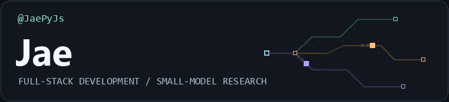

<picture>
  <source media="(prefers-reduced-motion: reduce)" srcset="./assets/profile-banner.png">
  
</picture>

I’m Jae, a developer in the Philippines. I build full-stack apps and study how small language models behave. I’m open to software development roles.

[Let’s talk on LinkedIn](https://www.linkedin.com/in/amjae/)

## Currently working on

- **CLMS** · Improving the Windows library workflows for barcode check-ins, book lending, and overdue fines. Daily records stay in SQLite so those workflows can run locally. The source is private.
- **AI safety thesis** · Testing whether quantization changes how often small language models produce harmful responses, and evaluating a safety layer that checks requests and responses.

## Selected work

- **[Bob the SAGE](https://github.com/JaePyJs/bob-the-sage)** · Maps how papers cite each other and shows how a research topic changes over time. 
  _Python, FastAPI, NetworkX, Next.js_

- **[Riri](https://github.com/JaePyJs/riri)** · Turns everyday Taglish into reminders that work offline. Users choose how the app talks to them, from Chill to Tita. 
  _Dart, Flutter, Riverpod, SQLite_

- **[NODEFALL](https://github.com/JaePyJs/nodefall)** · A 3D tower defense game where you place and upgrade defenses along a network path. 
  _TypeScript, Three.js, Vite_

- **[ChorusOps](https://github.com/JaePyJs/chorusops)** · A voice prototype that turns a startup pitch from a Discord call into a transcript and a scorecard. 
  _TypeScript, Speechmatics, Gemini_

**Team hackathons** · [GREPO](https://lablab.build/ai-hackathons/ibm-bob-2-hackathon/strawhat-pirates/grepo-find-your-way-through-the-code) for navigating codebases, and AMD team projects on [stock news sentiment](https://lablab.build/ai-hackathons/amd-developer/techvortex/sentiment-analysis-of-a-stock-data-on-news) and [agent routing](https://github.com/SajidHameed223/AMD_Hackaton-Team-0-1-).

## Tech stack

- **Web & backend** · TypeScript, React, Next.js, Node.js, Express, FastAPI
- **Data & apps** · Prisma, SQLite, Python, Flutter, Dart
- **Research** · Python, llama.cpp, Hugging Face

## Contribution snake

<picture>
  <source media="(prefers-color-scheme: dark)" srcset="https://raw.githubusercontent.com/JaePyJs/JaePyJs/output/github-contribution-grid-snake-dark.svg">
  
</picture>
